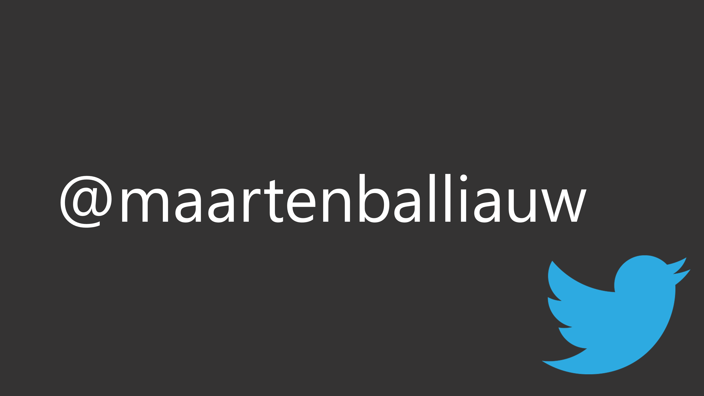

    
    

### Hi there 👋

My name is Maarten Balliauw.

> Maarten Balliauw loves building web and cloud apps. His main interests are in .NET web technologies, C#, Microsoft Azure and application performance. He is Head of Customer Success at Duende Software, creator of [SpeakerTravel](https://www.speaker.travel/), and formerly founded [MyGet](https://www.myget.org/). He's an ASP Insider and former Microsoft MVP. Maarten is a frequent speaker at various national and international events and organizes [Azure User Group](https://www.azug.be) events in Belgium. In his free time, he brews his own beer. Maarten's blog can be found at [https://blog.maartenballiauw.be](https://blog.maartenballiauw.be).

#### 📙 Recent blog posts
<!--START_SECTION:feed-->
* [UTCP vs MCP: what happens to agent auth without a server in the middle?](https:&#x2F;&#x2F;blog.maartenballiauw.be&#x2F;posts&#x2F;2026-11-10-utcp-auth-dcr-cimd-musings&#x2F;)
* [PartitionKey and RowKey in Azure Table Storage explained](https:&#x2F;&#x2F;blog.maartenballiauw.be&#x2F;posts&#x2F;2012-10-08-what-partitionkey-and-rowkey-are-for-in-windows-azure-table-storage&#x2F;)
* [ValidateAntiForgeryToken in ASP.NET Core: unit test for it](https:&#x2F;&#x2F;blog.maartenballiauw.be&#x2F;posts&#x2F;2019-01-11-unit-testing-for-validateantiforgerytoken-and-clever-navigation-in-the-resharper-rider-test-runner&#x2F;)
* [Call for Papers meaning: what happens after you submit](https:&#x2F;&#x2F;blog.maartenballiauw.be&#x2F;posts&#x2F;2019-08-27-what-happens-after-submitting-call-for-papers&#x2F;)
* [Run Azurite storage emulator in Docker with Rider](https:&#x2F;&#x2F;blog.maartenballiauw.be&#x2F;posts&#x2F;2020-06-09-run-azurite-in-docker-with-rider-and-keep-azure-storage-data-local-to-a-solution&#x2F;)
* [Server-Timing Headers in ASP.NET Core: Backend Metrics in Browser DevTools](https:&#x2F;&#x2F;blog.maartenballiauw.be&#x2F;posts&#x2F;2026-10-22-server-timing-headers-in-aspnet-core&#x2F;)
* [Device Bound Session Credentials in ASP.NET Core](https:&#x2F;&#x2F;blog.maartenballiauw.be&#x2F;posts&#x2F;2026-09-16-device-bound-session-credentials-in-aspnet-core&#x2F;)
* [System.Text.Json Polymorphic Deserialization](https:&#x2F;&#x2F;blog.maartenballiauw.be&#x2F;posts&#x2F;2020-01-29-deserializing-json-into-polymorphic-classes-with-systemtextjson&#x2F;)
* [Mastodon on your own domain without hosting a server](https:&#x2F;&#x2F;blog.maartenballiauw.be&#x2F;posts&#x2F;2022-11-05-mastodon-own-domain-without-hosting-server&#x2F;)
* [Fix CS8618 Nullable Warnings in C# JSON Models](https:&#x2F;&#x2F;blog.maartenballiauw.be&#x2F;posts&#x2F;2023-01-12-getting-rid-of-warnings-with-nullable-reference-types-and-json-object-models-in-csharp&#x2F;)
<!--END_SECTION:feed-->

#### ❓ Quick bits

* **Name:** Maarten Balliauw ([how to pronounce 🔉](https://github.com/maartenba/maartenba/raw/master/maarten-balliauw-name.mp3))
* **Age:** `DateTime.UtcNow.Year - 1983`
* **Gender:** male
* **Occupation:**
	* Frequent [speaker at various events](https://blog.maartenballiauw.be/talks-presentations.html) worldwide
	* Head of Customer Success at [Duende Software](https://www.duendesoftware.com/)
	* Founder and owner of [SpeakerTravel](https://www.speaker.travel/)
	* Former Head of Developer Advocacy at [JetBrains](https://www.jetbrains.com/)
	* Former founder and owner of [MyGet](https://www.myget.org/)
* **Location:** [Antwerp](https://en.wikipedia.org/wiki/Antwerp/), [Belgium](https://en.wikipedia.org/wiki/Belgium)
* **Favourite beer:** [Westmalle Tripel](https://www.trappistwestmalle.be/en/page/tripel.aspx), [Rochefort 10](https://en.wikipedia.org/wiki/Brasserie_de_Rochefort), [La Chouffe (Achouffe)](https://en.wikipedia.org/wiki/Brasserie_d%27Achouffe)
* **Quote:** "A developer is a machine that converts coffee into code"

#### 📨 Contact details

* **Email:** [maarten@maartenballiauw.be](mailto:maarten@maartenballiauw.be)
* **Twitter:** [@maartenballiauw](https://twitter.com/maartenballiauw)
* **X:** [@maartenballiauw](https://x.com/maartenballiauw)
* **Bluesky:** [@maartenballiauw.be](https://bsky.app/profile/maartenballiauw.be)
* **Mastodon:** [@maartenballiauw@mastodon.online](https://mastodon.online/@maartenballiauw)
* **GitHub:** [maartenba](https://github.com/maartenba)
* **LinkedIn:** [public profile](https://www.linkedin.com/in/maartenballiauw)

#### 💻 Open Source

I try to contribute to various open source projects, when time allows. Here are some examples:

* [Azure Toolkit for JetBrains Rider](https://github.com/JetBrains/azure-tools-for-intellij)
* [GoogleAnalyticsTracker](https://github.com/maartenba/GoogleAnalyticsTracker)
* [CamoDotNet](https://github.com/maartenba/CamoDotNet)
* ... and more!

Feel free to reach out to me on Twitter: [@maartenballiauw](https://twitter.com/maartenballiauw/)
